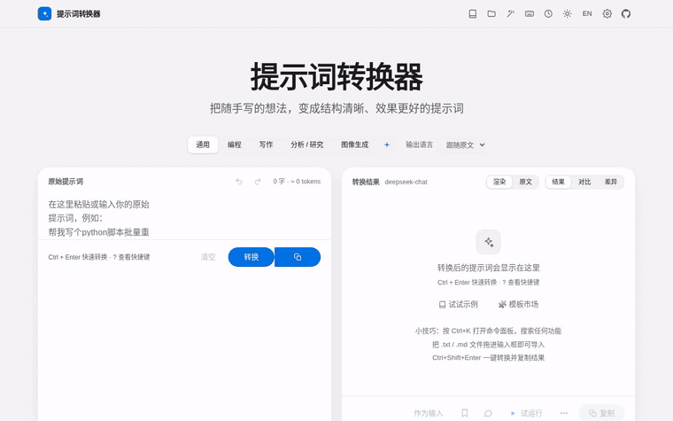
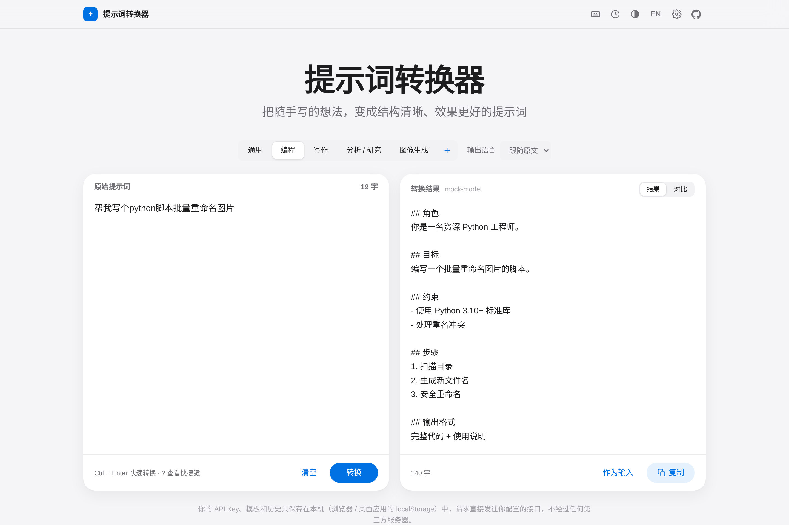
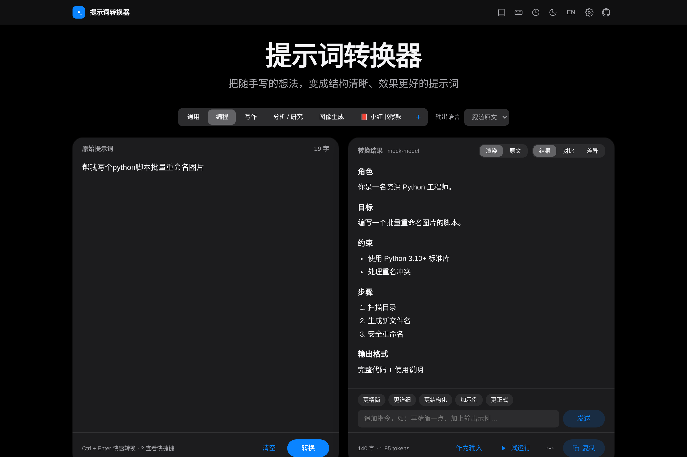

<div align="center">

# ✨ 提示词转换器 · Prompt Converter

**把随手写的想法，一键变成结构清晰、效果更好的提示词。**

纯前端 · 本地运行 · 自带 API Key · 支持任意 OpenAI 兼容接口

[English](#english) · [快速开始](#-快速开始本地部署) · [更新](#-更新--updating) · [隐私说明](#-隐私说明) · [路线图](#️-路线图)



<sub>演示使用模拟接口录制 · Demo recorded against a mock API</sub>

</div>

## 🚀 快速开始（本地部署）

> 需要 Node.js 18+。

```bash
git clone https://github.com/amlhdsan/prompt-converter.git
cd prompt-converter
npm install && npm run dev
# 打开 http://localhost:5173
```

**构建并本地预览生产版本：**

```bash
npm run build && npm run preview     # http://localhost:4173
# 或用任意静态服务器托管 dist/，例如：npx serve dist
```

**Docker 自托管：**

```bash
docker compose up -d                 # http://localhost:3000
```

打开页面 → 点击右上角 ⚙️ 设置 → 选择服务商并填入 API Key → 粘贴提示词 → 点击「✨ 转换」（或 `Ctrl/⌘ + Enter`）。

## 📸 截图 / Screenshots

| 浅色 Light | 深色 Dark |
| --- | --- |
|  |  |

## 🔄 更新 / Updating

应用启动时会（每 24 小时最多一次）检查 GitHub 上是否有新版本，有更新时在页面顶部提示；也可在 ⚙️ 设置中手动「检查更新」或关闭自动检查。离线时静默跳过。

The app checks GitHub for a newer release at most once per 24h (falls back to the latest commit on `main` if there are no releases) and shows a notice. You can check manually or disable it in Settings.

**一键更新（推荐，跨平台）/ One command:**

```bash
npm run update          # git pull + npm install + npm run build，并打印结果
```

**手动更新（git clone 用户）/ Manual:**

```bash
git pull && npm install && npm run build
```

**Docker：**

```bash
git pull && docker compose up -d --build
```

更新内容见 [CHANGELOG.md](CHANGELOG.md)。

## 🌟 功能

- 🧠 **结构化改写**：自动补全角色、目标、背景、约束、步骤、输出格式；缺失信息用 `[请补充: …]` 占位，不臆造事实
- 🎯 **五种场景**：通用 / 编程 / 写作 / 分析研究 / 图像生成（输出主提示词、英文关键词、负面提示词与参数建议）
- 🔌 **任意 OpenAI 兼容接口**：内置 DeepSeek、OpenAI、通义千问（DashScope 兼容模式），也可自定义 Base URL 与模型（Ollama、OneAPI、各类中转）
- ⚡ **流式输出**，可随时停止
- 🌐 **输出语言**：跟随原文 / 中文 / English
- 🔍 **原文 vs 结果对比视图**、一键复制、「作为输入」二次优化
- 🕘 **历史记录**（本地保存最近 30 条）
- 🌗 浅色 / 深色 / 跟随系统；🇨🇳 中文界面默认，可切换 English
- 🩺 **清晰的错误提示**：认证失败、跨域（CORS）、网络错误、接口错误分别提示

## 🔒 隐私说明

- **API Key 只保存在你浏览器的 `localStorage` 中**，不会上传到任何服务器。
- 本项目**没有后端**：请求直接从你的浏览器发往你配置的 API 地址。
- 历史记录同样只存在本地，可随时在「历史记录」中清空。
- 在公共电脑上使用后，建议清除浏览器站点数据。

> 💡 若某服务商不允许浏览器直接跨域请求（CORS），会提示错误；可改用支持 CORS 的接口或自建代理。DeepSeek、DashScope 兼容模式等通常可直连。

## 🧱 技术栈与结构

Vite + 原生 TypeScript，零运行时依赖，构建产物约 30KB。

```
src/
  main.ts      # UI 渲染与交互
  llm.ts       # OpenAI 兼容客户端（SSE 流式、错误分类）+ 服务商预设
  prompts.ts   # 各场景的系统提示词
  i18n.ts      # 中英文文案
  storage.ts   # localStorage 设置与历史
  style.css    # 主题样式
tests/
  mock-server.mjs  # 模拟 OpenAI 兼容接口（npm run mock）
  e2e.py           # Playwright 端到端测试
```

运行测试：`pip install playwright && playwright install chromium && npm run test:e2e`

## 🗺️ 路线图

- [x] v1：Web 版，多服务商，流式，多场景，历史记录，Docker
- [ ] 🖥️ Tauri 桌面版：全局快捷键唤起悬浮窗，选中文字一键转换并替换
- [ ] 自定义 / 导入导出场景模板
- [ ] 多版本对比、迭代追问优化
- [ ] 浏览器扩展
- [ ] 可选在线演示（GitHub Pages，工作流模板在 `docs/github-pages-deploy.yml`，启用时移到 `.github/workflows/`，使用 `BASE_PATH=/prompt-converter/`）

## 🤝 贡献

欢迎 Issue 与 PR！如果觉得有用，请点个 ⭐ Star 支持一下～

## 📄 License

[MIT](LICENSE)

---

<a id="english"></a>

## English

**Prompt Converter** turns rough, one-line prompts into well-structured, effective prompts (role, goal, context, constraints, steps, output format) using **your own LLM API key**. Pure frontend, no backend.

### Run locally

```bash
npm install && npm run dev                 # http://localhost:5173
npm run build && npm run preview           # http://localhost:4173
docker compose up -d                       # http://localhost:3000
```

Open ⚙️ Settings, pick a provider (DeepSeek / OpenAI / Qwen DashScope / custom OpenAI-compatible base URL + model), paste your key, then convert with `Ctrl/⌘ + Enter`.

### Features

Five modes (general, coding, writing, analysis/research, image generation) · streaming · output language (auto / 中文 / English) · original-vs-converted compare view · one-click copy · local history · dark/light/system theme · Chinese UI with English toggle · clear CORS/auth/network error messages.

### Privacy

Your API key and history are stored **only in your browser's localStorage**. Requests go directly from your browser to the endpoint you configure; there is no server in between.

### Roadmap

Tauri desktop app with a global-hotkey floating window · custom templates · browser extension · optional GitHub Pages demo.

License: MIT
