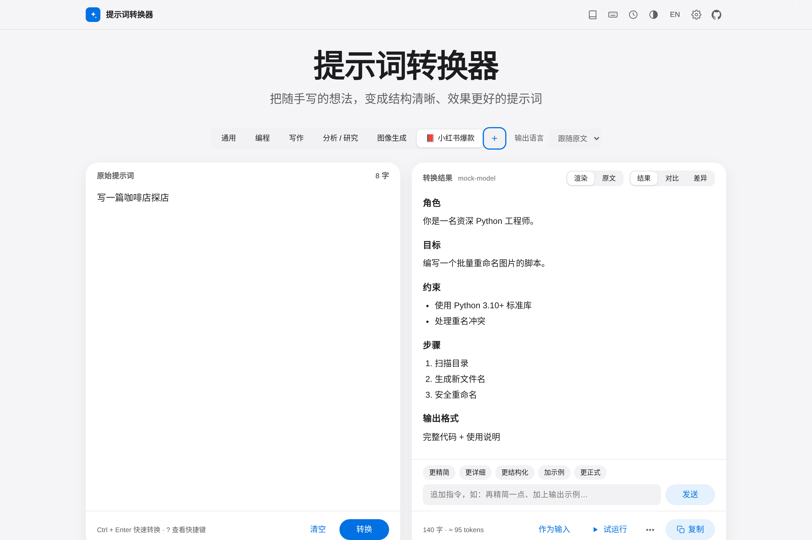
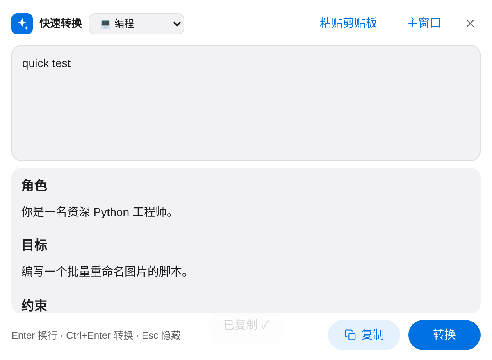

<div align="center">

# ✨ 提示词转换器 · Prompt Converter

**把随手写的想法，一键变成结构清晰、效果更好的提示词。**

纯前端 · 本地运行 · 自带 API Key · 12 个服务商 + 任意 OpenAI 兼容接口 · 可安装 PWA · 🖥️ Windows / macOS / Linux 桌面版

[English](#english) · [快速开始](#-快速开始本地部署) · [桌面版](#️-桌面版--desktop-app) · [快捷键](#️-快捷键--shortcuts) · [更新](#-更新--updating) · [隐私说明](#-隐私说明) · [路线图](#️-路线图)


<sub>演示使用模拟接口录制 · Demo recorded against a mock API</sub>

</div>

## 🚀 快速开始（本地部署）

> 需要 Node.js 18+。

```bash
git clone https://github.com/amlhdsan/prompt-converter.git
cd prompt-converter
npm install && npm run dev
# 打开 http://localhost:5173
```

**构建并本地预览生产版本：**

```bash
npm run build && npm run preview     # http://localhost:4173
# 或用任意静态服务器托管 dist/，例如：npx serve dist
```

**Docker 自托管：**

```bash
docker compose up -d                 # http://localhost:3000
```

打开页面 → 点击右上角 ⚙️ 设置 → 选择服务商并填入 API Key → 粘贴提示词 → 点击「✨ 转换」（或 `Ctrl/⌘ + Enter`）。

## 🖥️ 桌面版 / Desktop app

桌面版基于 **Tauri v2**，复用同一套界面，额外提供：

- ⌨️ **全局快捷键**（默认 `Ctrl + Shift + Space`，macOS 为 `⌘ + Shift + Space`）随时呼出 / 隐藏一个**置顶的快速转换悬浮窗**：自动读取剪贴板内容 → `Ctrl/⌘ + Enter` 转换 → 结果自动复制回剪贴板，直接粘贴即可
- 🧷 **系统托盘**：显示主窗口、快速转换、开机自启动开关、退出；关闭主窗口时应用驻留托盘
- 🌐 请求由本地原生 HTTP 客户端发出，**不受浏览器跨域（CORS）限制**，任何 OpenAI 兼容接口都能直连
- 🔔 启动时检查 GitHub Releases 新版本，点击即可在浏览器中打开下载页

**安装：** 前往 [Releases](https://github.com/amlhdsan/prompt-converter/releases) 下载对应平台的安装包：

| 平台 | 文件 | 说明 |
| --- | --- | --- |
| Windows | `*_x64-setup.exe` / `*.msi` | 双击安装（未签名时 SmartScreen 选择「更多信息 → 仍要运行」） |
| macOS | `*_aarch64.dmg`（Apple 芯片）/ `*_x64.dmg`（Intel） | 拖入「应用程序」；未签名时首次需右键 → 打开，或运行 `xattr -dr com.apple.quarantine "/Applications/Prompt Converter.app"` |
| Linux | `*.AppImage` / `*.deb` | `chmod +x *.AppImage && ./Prompt*.AppImage`，或 `sudo apt install ./Prompt*.deb` |

> Linux 说明：全局快捷键需要 X11（Wayland 下多数桌面不允许应用注册全局快捷键，可在系统设置中为 `prompt-converter` 自定义快捷键，或在 XWayland 下运行）；托盘图标需要 AppIndicator 支持（GNOME 请安装 AppIndicator 扩展）。

**修改快捷键 / 开机自启：** ⚙️ 设置 →「桌面版」→ 点击快捷键输入框，直接按下新的组合键（需包含 Ctrl/⌘ 或 Alt 等修饰键）；勾选「开机自启动」（也可在托盘菜单切换，自启时最小化到托盘）。

**从源码构建：**

```bash
# 需要 Rust（https://rustup.rs）；Linux 另需：
# sudo apt install libwebkit2gtk-4.1-dev libgtk-3-dev libayatana-appindicator3-dev librsvg2-dev libxdo-dev patchelf
npm install
npm run tauri:dev                          # 开发模式
npm run tauri:build                        # 产物在 src-tauri/target/release/bundle/
npx tauri build --bundles deb,appimage     # 仅构建 Linux 包
```

多平台安装包由 GitHub Actions 自动构建：工作流 [`.github/workflows/tauri-release.yml`](.github/workflows/tauri-release.yml)，推送 `v*` 标签即可构建 Windows / macOS / Linux 并上传到 Release。

## ⌨️ 快捷键 / Shortcuts

按 `?` 或点击右上角键盘图标可随时查看。

| 快捷键 | 功能 |
| --- | --- |
| `Ctrl/⌘ + Enter` | 转换 / 停止 |
| `Ctrl/⌘ + Shift + C` | 复制结果 |
| `Ctrl/⌘ + ,` | 打开设置 |
| `Ctrl/⌘ + Shift + H` | 打开历史记录 |
| `Ctrl/⌘ + Shift + T` | 管理模板 |
| `Alt + 1…9` | 切换到第 N 个场景 |
| `?` | 快捷键帮助 |
| `Esc` | 关闭弹窗 / 停止转换 / 隐藏悬浮窗 |
| `Ctrl/⌘ + Shift + Space` | （桌面版，全局）呼出 / 隐藏快速转换悬浮窗，可在设置中修改 |

## 📸 截图 / Screenshots

| 浅色 Light | 深色 Dark |
| --- | --- |
|  |  |

| 自定义模板 Templates | 快速转换悬浮窗 Quick window |
| --- | --- |
|  |  |

## 🔄 更新 / Updating

应用启动时会（每 24 小时最多一次）检查 GitHub 上是否有新版本，有更新时在页面顶部提示；也可在 ⚙️ 设置中手动「检查更新」或关闭自动检查。离线时静默跳过。

The app checks GitHub for a newer release at most once per 24h (falls back to the latest commit on `main` if there are no releases) and shows a notice. You can check manually or disable it in Settings.

**一键更新（推荐，跨平台）/ One command:**

```bash
npm run update          # git pull + npm install + npm run build，并打印结果
```

**桌面版**：有新版本时会提示，点击「查看更新内容」打开 Releases 页面，下载新安装包覆盖安装即可，设置、模板和历史都会保留。

**手动更新（git clone 用户）/ Manual:**

```bash
git pull && npm install && npm run build
```

**Docker：**

```bash
git pull && docker compose up -d --build
```

更新内容见 [CHANGELOG.md](CHANGELOG.md)。

## 🌟 功能

- 🧠 **结构化改写**：自动补全角色、目标、背景、约束、步骤、输出格式；缺失信息用 `[请补充: …]` 占位，不臆造事实
- 🎯 **五种场景**：通用 / 编程 / 写作 / 分析研究 / 图像生成（输出主提示词、英文关键词、负面提示词与参数建议）
- 🧩 **自定义模板**：点击场景栏的 ＋ 新建 / 编辑 / 删除自己的场景（名称、图标、转换指令），保存在本地并作为新场景出现
- 💾 **导入 / 导出**：设置 → 数据，一键导出设置、模板和历史为 JSON（可选是否包含 API Key），导入时按 ID 合并
- 🔌 **任意 OpenAI 兼容接口**：内置 DeepSeek、OpenAI、通义千问（DashScope 兼容模式），也可自定义 Base URL 与模型（Ollama、OneAPI、各类中转）
- ⚡ **流式输出**，可随时停止
- 🌐 **输出语言**：跟随原文 / 简体 / 繁體 / English / 日本語 / 한국어 / Français / Deutsch / Español / Русский，或自定义任意语言
- 🔍 **原文 vs 结果对比视图**、一键复制、「作为输入」二次优化
- 🕘 **历史记录**：本地保存最近 100 条，支持**搜索**、⭐ **收藏**（收藏不会被自动淘汰或清空）、单条删除
- ⌨️ **键盘快捷键**：`Ctrl/⌘ + Enter` 转换，按 `?` 查看全部快捷键
- 🖥️ **桌面版**：全局快捷键悬浮窗、剪贴板读写、托盘、开机自启（见上文）
- 🌗 浅色 / 深色 / 跟随系统；🇨🇳 中文界面默认，可切换 English
- 🩺 **清晰的错误提示**：认证失败、跨域（CORS）、网络错误、接口错误分别提示

## 🔒 隐私说明

- **API Key 只保存在你浏览器的 `localStorage` 中**，不会上传到任何服务器。
- 本项目**没有后端**：请求直接从你的浏览器发往你配置的 API 地址。
- 历史记录同样只存在本地，可随时在「历史记录」中清空。
- 在公共电脑上使用后，建议清除浏览器站点数据。

> 💡 若某服务商不允许浏览器直接跨域请求（CORS），会提示错误；可改用支持 CORS 的接口或自建代理。DeepSeek、DashScope 兼容模式等通常可直连。

## 🧱 技术栈与结构

Vite + 原生 TypeScript；Web 版运行时不加载任何桌面依赖（Tauri 相关代码按需懒加载）。

```
src/
  main.ts      # UI 渲染与交互
  llm.ts       # OpenAI 兼容客户端（SSE 流式、错误分类）+ 服务商预设
  prompts.ts   # 各场景的系统提示词
  i18n.ts      # 中英文文案
  storage.ts   # localStorage 设置、模板、历史、导入导出
  platform.ts  # 桌面版（Tauri）能力的懒加载封装：原生 HTTP、剪贴板、快捷键、自启
  update.ts    # GitHub Releases 更新检查
  style.css    # 主题样式
src-tauri/     # Tauri v2 桌面壳（托盘、全局快捷键、悬浮窗）
tests/
  mock-server.mjs  # 模拟 OpenAI 兼容接口（npm run mock）
  e2e.py           # Playwright 端到端测试
```

运行测试：`pip install playwright && playwright install chromium && npm run test:e2e`

## 🗺️ 路线图

- [x] v1：Web 版，多服务商，流式，多场景，历史记录，Docker
- [x] v1.2：自定义模板、导入导出、历史搜索与收藏、更多输出语言、快捷键
- [x] 🖥️ Tauri 桌面版：全局快捷键唤起悬浮窗、剪贴板、托盘、开机自启
- [ ] 桌面版：选中文字直接替换、应用内自动更新
- [ ] 多版本对比、迭代追问优化
- [ ] 浏览器扩展
- [ ] 可选在线演示（GitHub Pages，工作流模板在 `docs/github-pages-deploy.yml`，启用时移到 `.github/workflows/`，使用 `BASE_PATH=/prompt-converter/`）

## 🤝 贡献

欢迎 Issue 与 PR！如果觉得有用，请点个 ⭐ Star 支持一下～

## 📄 License

[MIT](LICENSE)

---

<a id="english"></a>

## English

**Prompt Converter** turns rough, one-line prompts into well-structured, effective prompts (role, goal, context, constraints, steps, output format) using **your own LLM API key**. Pure frontend, no backend.

### Run locally

```bash
npm install && npm run dev                 # http://localhost:5173
npm run build && npm run preview           # http://localhost:4173
docker compose up -d                       # http://localhost:3000
```

Open ⚙️ Settings, pick a provider (DeepSeek / OpenAI / Qwen DashScope / custom OpenAI-compatible base URL + model), paste your key, then convert with `Ctrl/⌘ + Enter`.

### Features

Five built-in modes (general, coding, writing, analysis/research, image generation) plus **your own custom templates** (create / edit / delete, stored locally) · streaming · output language (auto, 10 presets, or any custom language) · compare view · one-click copy · local history with **search and favorites** · **import/export** of settings, templates and history as JSON · **keyboard shortcuts** (`Ctrl/⌘ + Enter` to convert, press `?` for the full list) · dark/light/system theme · Chinese UI with English toggle · clear CORS/auth/network errors.

### Desktop app

Built with Tauri v2 for Windows, macOS and Linux — download from [Releases](https://github.com/amlhdsan/prompt-converter/releases) (`.exe`/`.msi`, `.dmg`, `.AppImage`/`.deb`).

- **Global hotkey** `Ctrl/⌘ + Shift + Space` (change it in Settings → Desktop) toggles a compact **always-on-top quick-convert window**: it reads the clipboard, converts with `Ctrl/⌘ + Enter`, and copies the result back to the clipboard.
- **Tray icon**: show window, quick convert, launch-at-login toggle, quit. Closing the main window keeps the app in the tray.
- Requests use a native HTTP client, so provider **CORS restrictions don't apply**.
- Update check against GitHub Releases; the notice opens the download page in your browser.
- Linux: the global hotkey needs X11 (most Wayland compositors block global shortcuts); the tray needs AppIndicator support.
- Build from source: install Rust, then `npm install && npm run tauri:build` (Linux deps listed above). CI: [`.github/workflows/tauri-release.yml`](.github/workflows/tauri-release.yml) builds all platforms when a `v*` tag is pushed.

### Shortcuts

`Ctrl/⌘+Enter` convert/stop · `Ctrl/⌘+Shift+C` copy result · `Ctrl/⌘+,` settings · `Ctrl/⌘+Shift+H` history · `Ctrl/⌘+Shift+T` templates · `Alt+1…9` switch mode · `?` help · `Esc` close/stop · desktop global: `Ctrl/⌘+Shift+Space`.

### Privacy

Your API key, templates and history are stored **only locally** (browser / desktop app localStorage). Requests go directly to the endpoint you configure; there is no server in between.

### Roadmap

Replace-selection in other apps · in-app auto-update · browser extension · optional GitHub Pages demo.

License: MIT
