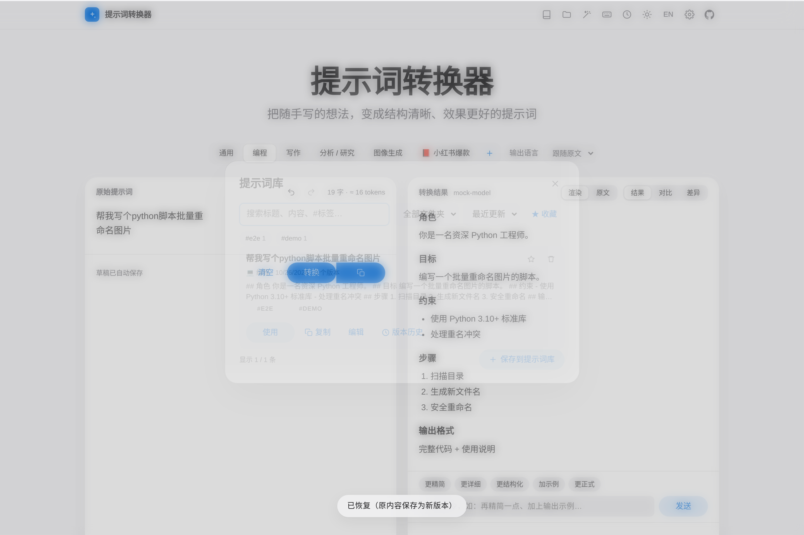
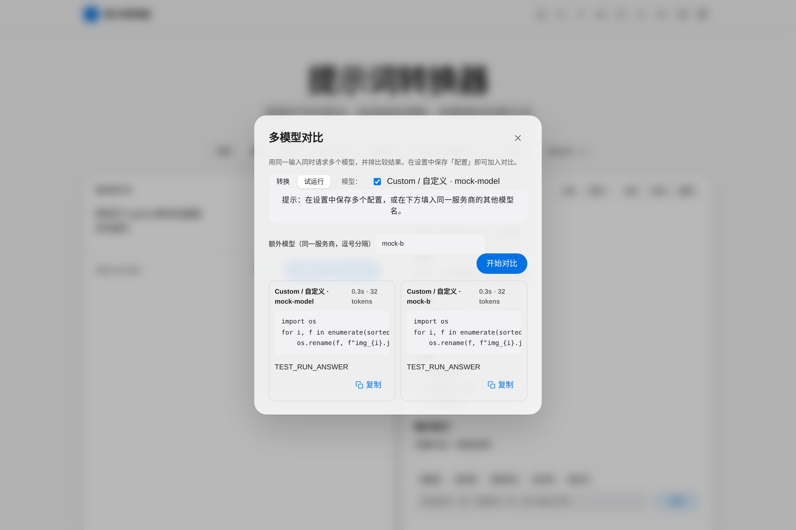
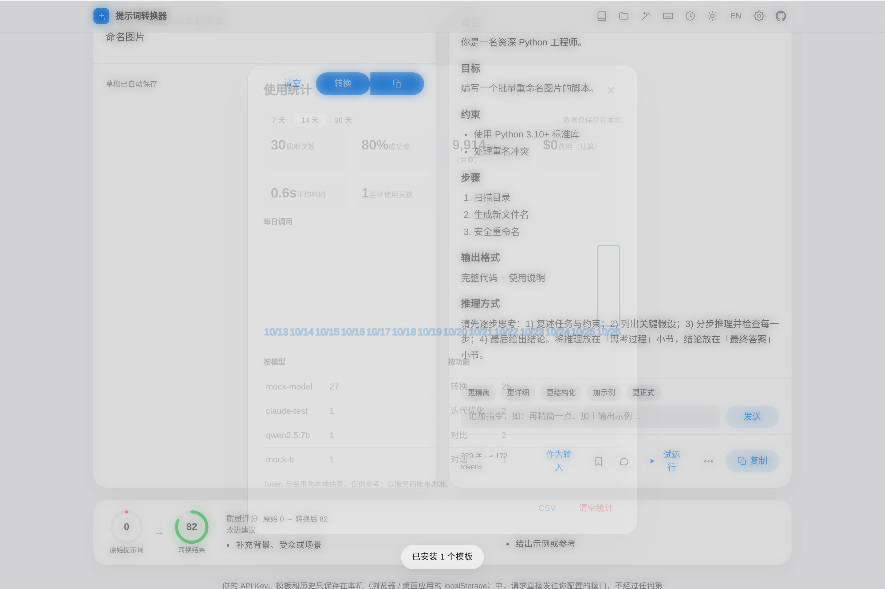
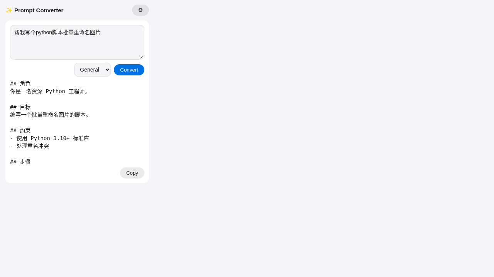

<div align="center">

# ✨ Prompt Converter · 提示词转换器

**Turn a rough one-liner into a structured, effective prompt — with your own API key, nothing sent anywhere else.**<br/>
**把随手写的一句话，变成结构清晰、效果更好的提示词。自带 Key，数据不经任何第三方。**

[](https://github.com/amlhdsan/prompt-converter/actions/workflows/ci.yml) [](https://github.com/amlhdsan/prompt-converter/releases/latest) [](https://github.com/amlhdsan/prompt-converter/releases) [](LICENSE)


<sub>Recorded against a mock API · 演示使用模拟接口录制</sub>

[English](#english) · [快速开始](#-30-秒上手--quick-start) · [亮点](#-亮点--highlights) · [桌面版](#️-桌面版--desktop-app) · [浏览器扩展](#-浏览器扩展--browser-extension) · [隐私](#-隐私说明) · [更新日志](CHANGELOG.md)

</div>

## ⚡ 30 秒上手 / Quick start

| 方式 Option | 步骤 Steps |
| --- | --- |
| 🖥️ **桌面版 Desktop** (Windows / macOS / Linux) | 从 [Releases](https://github.com/amlhdsan/prompt-converter/releases/latest) 下载安装包 → 打开 → 按 `Ctrl/⌘+Shift+Space` 呼出悬浮窗 / Download an installer, open it, press `Ctrl/⌘+Shift+Space` for the quick window |
| 🌐 **网页版 Web** | `git clone https://github.com/amlhdsan/prompt-converter && cd prompt-converter && npm install && npm run dev` → http://localhost:5173 （可安装为 PWA / installable as a PWA） |
| 🐳 **Docker** | `docker compose up -d` → http://localhost:3000 |
| 🧩 **Chrome 扩展 Extension** | 下载 Releases 里的 `prompt-converter-extension-*.zip` → `chrome://extensions` → 加载已解压的扩展 / Load unpacked |

**没有 API Key？** 首次打开选「先看看演示」即可体验全部界面（演示模式，不会发任何请求）。有 Key 的话，跟着引导：选服务商 → 填 Key → 测试连接 → 跑一次示例。
**No key yet?** Pick “Try the demo first” on the welcome screen — sample results, zero requests. Otherwise the guide takes about a minute: provider → key → connection test → sample.

## 🌟 亮点 / Highlights

- 🧠 **结构化改写 Structured rewrite** — role, goal, context, constraints, steps, output format; unknown facts become `[请补充: …]` placeholders instead of being invented
- 🔌 **12 个服务商 + 任意 OpenAI 兼容接口 / 12 providers + any OpenAI-compatible endpoint** (incl. Ollama, OneAPI relays); streaming, retries, clear errors
- 📚 **提示词库 Prompt library** — tags, folders, stars, search, per-prompt version history with diff & restore
- 🆚 **多模型对比 Compare** models side by side · 💬 **对话 Chat** with the result as the system prompt
- 🧰 **技巧工具箱 Toolbox** — chain of thought, few-shot, role, JSON schema, explain, structure-preserving translation, Midjourney / SD / DALL·E params
- 🧩 **模板市场 Template gallery** — bundled packs, import by URL/JSON · 📦 batch convert · 🕘 history
- ✍️ **顺手 Little things** — autosaved drafts, undo/redo, drag-in text files, token counter, mode auto-suggest, convert & copy in one key, undo toasts
- 🖥️ **桌面版 Desktop** — global hotkey quick window, convert-selection hotkey, tray, mini always-on-top mode
- ☁️ **同步 Sync** to your own WebDAV or private Gist · 📊 local usage stats · 🌗 dark mode · 中文 / English / 日本語
- 🔒 **隐私 Privacy** — pure frontend, key stays on your device, requests go straight to your provider

---

<h2 align="center">📖 完整文档 / Full documentation</h2>

## 🚀 本地部署详情

> 需要 Node.js 18+。

```bash
git clone https://github.com/amlhdsan/prompt-converter.git
cd prompt-converter
npm install && npm run dev
# 打开 http://localhost:5173
```

**构建并本地预览生产版本：**

```bash
npm run build && npm run preview     # http://localhost:4173
# 或用任意静态服务器托管 dist/，例如：npx serve dist
```

**Docker 自托管：**

```bash
docker compose up -d                 # http://localhost:3000
```

打开页面 → 点击右上角 ⚙️ 设置 → 选择服务商并填入 API Key → 粘贴提示词 → 点击「✨ 转换」（或 `Ctrl/⌘ + Enter`）。

## 🖥️ 桌面版 / Desktop app

桌面版基于 **Tauri v2**，复用同一套界面，额外提供：

- ⌨️ **全局快捷键**（默认 `Ctrl + Shift + Space`，macOS 为 `⌘ + Shift + Space`）随时呼出 / 隐藏一个**置顶的快速转换悬浮窗**：自动读取剪贴板内容 → `Ctrl/⌘ + Enter` 转换 → 结果自动复制回剪贴板，直接粘贴即可
- 🧷 **系统托盘**：显示主窗口、快速转换、开机自启动开关、退出；关闭主窗口时应用驻留托盘
- 🌐 请求由本地原生 HTTP 客户端发出，**不受浏览器跨域（CORS）限制**，任何 OpenAI 兼容接口都能直连
- 🔔 启动时检查 GitHub Releases 新版本，点击即可在浏览器中打开下载页

**安装：** 前往 [Releases](https://github.com/amlhdsan/prompt-converter/releases) 下载对应平台的安装包：

| 平台 | 文件 | 说明 |
| --- | --- | --- |
| Windows | `*_x64-setup.exe` / `*.msi` | 双击安装（未签名时 SmartScreen 选择「更多信息 → 仍要运行」） |
| macOS | `*_aarch64.dmg`（Apple 芯片）/ `*_x64.dmg`（Intel） | 拖入「应用程序」；未签名时首次需右键 → 打开，或运行 `xattr -dr com.apple.quarantine "/Applications/Prompt Converter.app"` |
| Linux | `*.AppImage` / `*.deb` | `chmod +x *.AppImage && ./Prompt*.AppImage`，或 `sudo apt install ./Prompt*.deb` |

> Linux 说明：全局快捷键需要 X11（Wayland 下多数桌面不允许应用注册全局快捷键，可在系统设置中为 `prompt-converter` 自定义快捷键，或在 XWayland 下运行）；托盘图标需要 AppIndicator 支持（GNOME 请安装 AppIndicator 扩展）。

**修改快捷键 / 开机自启：** ⚙️ 设置 →「桌面版」→ 点击快捷键输入框，直接按下新的组合键（需包含 Ctrl/⌘ 或 Alt 等修饰键）；勾选「开机自启动」（也可在托盘菜单切换，自启时最小化到托盘）。

**从源码构建：**

```bash
# 需要 Rust（https://rustup.rs）；Linux 另需：
# sudo apt install libwebkit2gtk-4.1-dev libgtk-3-dev libayatana-appindicator3-dev librsvg2-dev libxdo-dev patchelf
npm install
npm run tauri:dev                          # 开发模式
npm run tauri:build                        # 产物在 src-tauri/target/release/bundle/
npx tauri build --bundles deb,appimage     # 仅构建 Linux 包
```

多平台安装包由 GitHub Actions 自动构建：工作流 [`.github/workflows/tauri-release.yml`](.github/workflows/tauri-release.yml)，推送 `v*` 标签即可构建 Windows / macOS / Linux 并上传到 Release。

## ⌨️ 快捷键 / Shortcuts

按 `?` 或点击右上角键盘图标可随时查看。

| 快捷键 | 功能 |
| --- | --- |
| `Ctrl/⌘ + Enter` | 转换 / 停止 |
| `Ctrl/⌘ + K` | 命令面板（搜索任意操作 / 场景） |
| `Ctrl/⌘ + Shift + B` | 批量转换 |
| `Ctrl/⌘ + Shift + R` | 试运行 |
| `Ctrl/⌘ + Shift + E` | 示例库 |
| `Ctrl/⌘ + Shift + C` | 复制结果 |
| `Ctrl/⌘ + ,` | 打开设置 |
| `Ctrl/⌘ + Shift + H` | 打开历史记录 |
| `Ctrl/⌘ + Shift + T` | 管理模板 |
| `Ctrl/⌘ + Shift + Enter` | 转换并复制结果 |
| `Ctrl/⌘ + S` | 保存结果到提示词库 |
| `Ctrl/⌘ + Shift + L` | 打开提示词库 |
| `Ctrl/⌘ + Z` / `Ctrl/⌘ + Shift + Z` | 输入框撤销 / 重做 |
| `Alt + 1…9` | 切换到第 N 个场景 |
| `?` | 快捷键帮助 |
| `Esc` | 关闭弹窗 / 停止转换 / 隐藏悬浮窗 |
| `Ctrl/⌘ + Shift + Space` | （桌面版，全局）呼出 / 隐藏快速转换悬浮窗，可在设置中修改 |
| `Ctrl/⌘ + Alt + Space` | （桌面版，全局）**划词转换**：复制任意应用中选中的文字并在悬浮窗中转换，可修改或关闭 |

## 📸 截图 / Screenshots

| 浅色 Light | 深色 Dark |
| --- | --- |
|  |  |

| 自定义模板 Templates | 快速转换悬浮窗 Quick window |
| --- | --- |
|  |  |

| 新手引导 Onboarding | 提示词库 Library |
| --- | --- |
|  |  |

| 多模型对比 Compare | 模板市场 Gallery |
| --- | --- |
|  |  |

| 使用统计 Stats | 浏览器扩展 Extension |
| --- | --- |
|  |  |

## 🔄 更新 / Updating

应用启动时会（每 24 小时最多一次）检查 GitHub 上是否有新版本，有更新时在页面顶部提示；也可在 ⚙️ 设置中手动「检查更新」或关闭自动检查。离线时静默跳过。

The app checks GitHub for a newer release at most once per 24h (falls back to the latest commit on `main` if there are no releases) and shows a notice. You can check manually or disable it in Settings.

**一键更新（推荐，跨平台）/ One command:**

```bash
npm run update          # git pull + npm install + npm run build，并打印结果
```

**桌面版**：有新版本时会提示，点击「查看更新内容」打开 Releases 页面，下载新安装包覆盖安装即可，设置、模板和历史都会保留。

**手动更新（git clone 用户）/ Manual:**

```bash
git pull && npm install && npm run build
```

**Docker：**

```bash
git pull && docker compose up -d --build
```

更新内容见 [CHANGELOG.md](CHANGELOG.md)。

## 🌟 功能

**v1.5 新增：更好上手，更多功能**

- 👋 **新手引导**：选服务商 → 填 Key → 测试连接 → 跑一次示例，一分钟完成；没有 Key 也能先用 **演示模式** 体验全部界面
- ✍️ **输入体验**：草稿自动保存、撤销 / 重做、拖入 `.txt/.md` 等文本文件、字数与 token 计数、根据输入**自动推荐场景**、**一键转换并复制**；生成时显示骨架屏、耗时与速度；清空 / 删除都可「撤销」
- ⚙️ **设置更简单**：常用 / 全部 两档视图 + 设置搜索；外观可选强调色、字号、紧凑布局、减少动画
- 📚 **提示词库**：标签、文件夹、搜索、星标、按使用次数排序，每条提示词有**版本历史**（对比差异、一键恢复）
- 🆚 **多模型对比**：同一输入同时发给多个配置 / 模型，并排比较耗时与结果
- 💬 **对话模式**：直接用转换后的提示词作为 system prompt 与模型多轮对话，可导出
- 🧰 **技巧工具箱**：思维链、少样本示例、角色设定、JSON Schema 输出、提示词解析、保持结构的翻译、Midjourney / Stable Diffusion / DALL·E 参数
- 🧩 **模板市场**：内置 4 个模板包（15 个模板）一键安装，也可通过 URL 或 JSON 导入别人分享的模板包
- 📊 **使用统计**：调用次数、成功率、Token 与费用估算、平均耗时、按模型 / 功能分布、每日趋势（仅存本机，可关闭、导出 CSV）
- ☁️ **云同步**：同步到你自己的 WebDAV（坚果云、Nextcloud…）或私有 GitHub Gist，按 ID 合并，默认不同步 API Key
- 🧩 **Chrome 浏览器扩展**：右键「转换为结构化提示词」，在 ChatGPT / Claude / Gemini / DeepSeek / Kimi 输入框旁一键 ✨ 优化（见下文）
- 🖥️ **桌面版**：划词转换全局快捷键、托盘菜单切换场景、迷你置顶模式

**v1.4 新增**

- 🧰 **命令面板** `Ctrl/⌘ + K`：模糊搜索所有操作、场景和对话框
- 📦 **批量转换**：每行一条（或用 `---` 分隔多行提示词），并发 2 条，自动写入历史，可复制全部 / 导出 Markdown
- ✍️ **填写占位**：结果中的 `[请补充：…]` / `[TODO: …]` 一键弹出表单填写并替换
- 🛠️ **内置场景指令编辑器**：可修改 5 个内置场景发给模型的改写指令，随时「恢复默认」
- 🔌 **测试连接**：设置中一键验证 Base URL / Key / 模型，显示延迟
- 📝 **历史导出 Markdown**；🇯🇵 **日本語界面**（中文 → English → 日本語 循环切换）
- 🛡️ **稳定性**：瞬时错误（429 / 5xx / 网络 / 超时）自动退避重试（可设 0–3 次，遵循 Retry-After，仅在尚未收到输出时重试）；最后一次重试自动改用非流式；流式输出中途卡住时保留已收到的部分；离开页面时中止请求；全局错误边界 + 恢复界面 + 可复制的本地错误日志；本地数据带版本迁移、损坏自动恢复（原数据备份）、存储已满时自动淘汰旧历史、多标签页实时同步
- 🖥️ **桌面版稳定性**：窗口位置/大小在移动或缩放后自动保存（防抖）、单实例运行、全局快捷键注册失败时界面提示、Rust panic 写入日志不再连锁崩溃

- 🧠 **结构化改写**：自动补全角色、目标、背景、约束、步骤、输出格式；缺失信息用 `[请补充: …]` 占位，不臆造事实
- 🎯 **五种场景**：通用 / 编程 / 写作 / 分析研究 / 图像生成（输出主提示词、英文关键词、负面提示词与参数建议）
- 🧩 **自定义模板**：点击场景栏的 ＋ 新建 / 编辑 / 删除自己的场景（名称、图标、转换指令），保存在本地并作为新场景出现
- 💾 **导入 / 导出**：设置 → 数据，一键导出设置、模板和历史为 JSON（可选是否包含 API Key），导入时按 ID 合并
- 🔌 **任意 OpenAI 兼容接口**：内置 DeepSeek、OpenAI、通义千问（DashScope 兼容模式），也可自定义 Base URL 与模型（Ollama、OneAPI、各类中转）
- ⚡ **流式输出**，可随时停止
- 🌐 **输出语言**：跟随原文 / 简体 / 繁體 / English / 日本語 / 한국어 / Français / Deutsch / Español / Русский，或自定义任意语言
- 🔍 **原文 vs 结果对比视图**、一键复制、「作为输入」二次优化
- 🕘 **历史记录**：本地保存最近 100 条，支持**搜索**、⭐ **收藏**（收藏不会被自动淘汰或清空）、单条删除
- ⌨️ **键盘快捷键**：`Ctrl/⌘ + Enter` 转换，按 `?` 查看全部快捷键
- 🖥️ **桌面版**：全局快捷键悬浮窗、剪贴板读写、托盘、开机自启（见上文）
- 🌗 浅色 / 深色 / 跟随系统；🇨🇳 中文界面默认，可切换 English
- 🩺 **清晰的错误提示**：认证失败、跨域（CORS）、网络错误、接口错误分别提示

## 🧩 浏览器扩展 / Browser extension

从 [Releases](https://github.com/amlhdsan/prompt-converter/releases) 下载 `prompt-converter-extension-x.y.z.zip`，解压后在 `chrome://extensions` 打开「开发者模式」→「加载已解压的扩展程序」选择该目录（Edge / Brave 等 Chromium 浏览器同理）。也可以自己构建：`npm run build:ext`（输出到 `dist-ext/`）。

- 点击工具栏图标：快速转换 + 设置（服务商、Key、模型、输出语言；Key 只存在 `chrome.storage.local`）
- 任意网页选中文字 → 右键「✨ 转换为结构化提示词」，结果卡片可复制或替换输入框
- 在 ChatGPT / Claude / Gemini / DeepSeek / Kimi 的输入框旁出现「✨ 优化提示词」按钮，原地改写

Download the extension zip from Releases, unzip, then load it via `chrome://extensions` → Developer mode → Load unpacked. Popup quick convert + settings, right-click any selection, and a ✨ button next to the chat box on popular AI sites. It reuses the app's conversion core.

## 🔒 隐私说明

- **API Key 只保存在你浏览器的 `localStorage` 中**，不会上传到任何服务器。
- 本项目**没有后端**：请求直接从你的浏览器发往你配置的 API 地址。
- 历史记录同样只存在本地，可随时在「历史记录」中清空。
- 在公共电脑上使用后，建议清除浏览器站点数据。

> 💡 若某服务商不允许浏览器直接跨域请求（CORS），会提示错误；可改用支持 CORS 的接口或自建代理。DeepSeek、DashScope 兼容模式等通常可直连。

## 🧱 技术栈与结构

Vite + 原生 TypeScript；Web 版运行时不加载任何桌面依赖（Tauri 相关代码按需懒加载）。

```
src/
  main.ts      # 应用外壳：渲染、全局错误边界、快捷键、命令面板
  llm.ts       # OpenAI / Anthropic 客户端（SSE 流式、重试退避、卡顿检测、非流式回退、错误分类）
  providers.ts # 12 个服务商预设
  lib/         # 纯逻辑：sse、diff、quality、tokens、share、markdown、placeholders、batch、export、errlog
  ui/          # 状态、DOM 工具、操作、输出区、悬浮窗、各类对话框（设置/历史/模板/工具）
  prompts.ts   # 各场景的系统提示词
  i18n.ts      # 中 / 英 / 日 文案（i18n.ja.ts）
  storage.ts   # 带版本迁移的本地存储：设置、模板、历史、导入导出、损坏恢复、多标签同步
  platform.ts  # 桌面版（Tauri）能力的懒加载封装：原生 HTTP、剪贴板、快捷键、自启
  update.ts    # GitHub Releases 更新检查
  style.css    # 主题样式
src-tauri/     # Tauri v2 桌面壳（托盘、全局快捷键、悬浮窗）
tests/
  mock-server.mjs  # 模拟 OpenAI 兼容接口（npm run mock）
  e2e.py           # Playwright 端到端测试
  unit/            # Vitest 单元测试
```

运行测试：

```bash
npm run lint && npm run typecheck   # ESLint + TypeScript 严格模式
npm run test:unit                   # Vitest 单元测试（SSE 解析、服务商请求/响应、存储迁移、导入导出、diff、评分、分享编码、i18n 完整性…）
pip install playwright && playwright install chromium && npm run test:e2e   # Playwright 端到端
```

每次 push / PR 都会在 [CI](https://github.com/amlhdsan/prompt-converter/actions/workflows/ci.yml) 中运行 lint、类型检查、单元测试、端到端测试、构建和 `cargo check`。

## 🗺️ 路线图

- [x] v1：Web 版，多服务商，流式，多场景，历史记录，Docker
- [x] v1.2：自定义模板、导入导出、历史搜索与收藏、更多输出语言、快捷键
- [x] 🖥️ Tauri 桌面版：全局快捷键唤起悬浮窗、剪贴板、托盘、开机自启
- [x] v1.3：多版本、迭代优化、质量评分、试运行、PWA
- [x] v1.4：稳定性（重试/恢复/错误边界/迁移）、命令面板、批量转换、占位填写、日语界面、CI
- [ ] 桌面版：选中文字直接替换、应用内自动更新（需要签名密钥，见 CHANGELOG）
- [ ] 浏览器扩展
- [ ] 可选在线演示（GitHub Pages，工作流模板在 `docs/github-pages-deploy.yml`，启用时移到 `.github/workflows/`，使用 `BASE_PATH=/prompt-converter/`）

## 🤝 贡献

欢迎 Issue 与 PR！如果觉得有用，请点个 ⭐ Star 支持一下～

## 📄 License

[MIT](LICENSE)

---

<a id="english"></a>

## English

**Prompt Converter** turns rough, one-line prompts into well-structured, effective prompts (role, goal, context, constraints, steps, output format) using **your own LLM API key**. Pure frontend, no backend.

### Run locally

```bash
npm install && npm run dev                 # http://localhost:5173
npm run build && npm run preview           # http://localhost:4173
docker compose up -d                       # http://localhost:3000
```

Open ⚙️ Settings, pick a provider (DeepSeek / OpenAI / Qwen DashScope / custom OpenAI-compatible base URL + model), paste your key, then convert with `Ctrl/⌘ + Enter`.

### Features

Five built-in modes (general, coding, writing, analysis/research, image generation) plus **your own custom templates** (create / edit / delete, stored locally) · streaming · output language (auto, 10 presets, or any custom language) · compare view · one-click copy · local history with **search and favorites** · **import/export** of settings, templates and history as JSON · **keyboard shortcuts** (`Ctrl/⌘ + Enter` to convert, press `?` for the full list) · dark/light/system theme · Chinese UI with English toggle · clear CORS/auth/network errors.

**New in 1.5:** guided onboarding (provider → key → connection test → sample) and a no-key **demo mode**; autosaved drafts, undo/redo, drag-and-drop text files, character/token counter, smart mode suggestion, one-click convert & copy, progress skeleton, undo for destructive actions; simpler Settings (basic/all + search) with accent color, text size, compact layout and reduced motion; a **prompt library** with tags, folders, stars, search and per-prompt **version history**; **multi-model compare**; **chat** with the converted prompt as the system prompt; a **techniques toolbox** (chain of thought, few-shot, role, JSON schema, explain, structure-preserving translate, Midjourney/SD/DALL·E params); a **template gallery** (bundled packs + import by URL/JSON); a local **usage dashboard**; **WebDAV / GitHub Gist sync**; a **Chrome extension**; desktop convert-selection hotkey (`Ctrl/⌘+Alt+Space`), tray mode menu and mini always-on-top mode.

**New in 1.4:** command palette (`Ctrl/⌘+K`), batch convert (one prompt per line or `---`-separated, export as Markdown), fill-in form for `[TODO: …]` placeholders, editable instructions for built-in modes, provider connection test, history export as Markdown, Japanese UI. Stability: automatic retry with backoff for transient errors (before any output arrives, honours Retry-After, last attempt falls back to non-streaming), partial output kept when a stream stalls, requests aborted on navigation, global error boundary with recovery screen and a copyable local error log, versioned storage with migrations, corruption recovery, quota fallback and multi-tab sync. Desktop: debounced window-state saving, single instance, hotkey-failure banner, panic-safe Rust shell.

### Desktop app

Built with Tauri v2 for Windows, macOS and Linux — download from [Releases](https://github.com/amlhdsan/prompt-converter/releases) (`.exe`/`.msi`, `.dmg`, `.AppImage`/`.deb`).

- **Global hotkey** `Ctrl/⌘ + Shift + Space` (change it in Settings → Desktop) toggles a compact **always-on-top quick-convert window**: it reads the clipboard, converts with `Ctrl/⌘ + Enter`, and copies the result back to the clipboard.
- **Tray icon**: show window, quick convert, launch-at-login toggle, quit. Closing the main window keeps the app in the tray.
- Requests use a native HTTP client, so provider **CORS restrictions don't apply**.
- Update check against GitHub Releases; the notice opens the download page in your browser.
- Linux: the global hotkey needs X11 (most Wayland compositors block global shortcuts); the tray needs AppIndicator support.
- Build from source: install Rust, then `npm install && npm run tauri:build` (Linux deps listed above). CI: [`.github/workflows/tauri-release.yml`](.github/workflows/tauri-release.yml) builds all platforms when a `v*` tag is pushed.

### Shortcuts

`Ctrl/⌘+Enter` convert/stop · `Ctrl/⌘+Shift+Enter` convert & copy · `Ctrl/⌘+S` save to library · `Ctrl/⌘+Shift+L` library · `Ctrl/⌘+K` command palette · `Ctrl/⌘+Shift+B` batch convert · `Ctrl/⌘+Shift+C` copy result · `Ctrl/⌘+,` settings · `Ctrl/⌘+Shift+H` history · `Ctrl/⌘+Shift+T` templates · `Alt+1…9` switch mode · `?` help · `Esc` close/stop · desktop global: `Ctrl/⌘+Shift+Space` (quick window), `Ctrl/⌘+Alt+Space` (convert selection).

### Privacy

Your API key, templates and history are stored **only locally** (browser / desktop app localStorage). Requests go directly to the endpoint you configure; there is no server in between.

### Roadmap

In-app auto-update (needs a signing key) · Firefox extension · optional GitHub Pages demo.

License: MIT

## 日本語

**Prompt Converter** は、思いつきの一文を、役割・目標・制約・手順・出力形式を備えた構造化プロンプトに変換するツールです（自分の API キーを使用、バックエンドなし）。UI は 日本語 / 中文 / English に対応。

- 初回ガイド（プロバイダー → キー → 接続テスト → サンプル）と、キー不要のデモモード
- プロンプトライブラリ（タグ・フォルダー・スター・バージョン履歴）、複数モデル比較、チャット、テクニック工具箱、テンプレートギャラリー、利用統計、WebDAV / Gist 同期
- デスクトップ版（Windows / macOS / Linux）と Chrome 拡張機能は [Releases](https://github.com/amlhdsan/prompt-converter/releases) から
- 起動：`npm install && npm run dev` → http://localhost:5173
